# Architecture Specification — Project "Extra" for Linux (v0.3.0)

**Document Version:** 1.1.0 (v0.3.0 Standard Audited)  
**Target Platform:** Linux Kernel 6.x+ (Arch Linux / yantraOS, Fedora, Ubuntu, Debian)  
**Supported Architectures:** `x86_64` (Intel/AMD) & `aarch64` (ARM64)  
**Parent Project:** yantraOS (`AIYantra`)  

---

## 1. System Architecture Overview

Extra for Linux is structured into decoupled layers engineered to deliver sub-10ms local perception and deterministic execution across modern Linux desktop environments (both Wayland and X11), while preserving the 100% standardized **Model Context Protocol (MCP)** interface for host AI assistants.

```mermaid
flowchart TD
    subgraph HostAI["Host AI Assistant Environment"]
        Agent["AI Assistant (Antigravity / Claude Desktop / Cursor / AGY)"]
    end

    subgraph InterfaceLayer["Interface & Protocol Layer (Cross-Platform)"]
        MCPServer["MCP Server (JSON-RPC 2.0 via stdio/SSE)"]
        CLIEngine["Extra CLI & Diagnostic Runner (cli.py)"]
    end

    subgraph CoreEngine["Extra 'Flashless' Core Engine (Linux Native)"]
        Router["Action Dispatcher & Safety Gate"]

        subgraph SOUL["Project SOUL (System One Reflex Layer)"]
            SOULEyes["SOUL-Eyes (Edge Semantic Visual Grounding)"]
            SOULGateman["SOUL-Gateman (Sub-15ms Visual Settle extra_soul_wait)"]
            DynamicBatch["Dynamic Batching Decider (eval, assert, wait_for_state)"]
        end
        
        subgraph Perception["Perception Engine"]
            KWinCap["KWin ScreenShot2 D-Bus (< 4ms)"]
            XShmCap["X11 MIT-SHM via mss (< 3ms)"]
            PortalCap["XDG ScreenCast Portal + PipeWire (< 5ms)"]
            ActiveWin["Active Window Telemetry (title & window ID)"]
            DPI["XRandR / QScreen Geometry & DPI Normalizer"]
        end

        subgraph Semantic["Semantic Engine (The Astra 6 Killer)"]
            ATSPITree["AT-SPI2 D-Bus System-Wide Client (org.a11y.Bus)"]
            ElementResolver["BoundingRect & Control Property Resolver"]
            SoM["Set-of-Mark (SoM) Badge Labeler"]
        end

        subgraph Injection["Input & Execution Engine"]
            HybridUInput["Kernel /dev/uinput (EV_ABS + EV_REL Hybrid evdev Device)"]
            XTestInj["X11 XTest Fake Events (libXtst Fallback)"]
            TerminalPaste["Terminal-Aware Atomic Clipboard Swap (Ctrl+V / Ctrl+Shift+V)"]
            BezierFlight["Biomechanical Human-Curvature Motor Flight"]
            InkVerifier["Programmatic Inking Pre/Post Pixel Delta Verifier"]
        end

        subgraph Resilience["Resilience & Safety"]
            StallBreaker["Perceptual Hash Diff & 2-Strike Stall Breaker"]
            KillSwitch["Fail-Safe Corner (0, 0) & Global Escape Hook"]
        end

        subgraph AmbientAwareness["Ambient Awareness & Feedback"]
            QtOverlay["PySide6 Translucent HUD (WindowTransparentForInput)"]
            AudioSynth["Procedural Acoustic Glass Marimba Synthesizer"]
        end
    end

    subgraph FastPath["Fast-Path Accelerators"]
        BrowserFast["Playwright / Chromium CDP DOM Extractor"]
        ShellFast["XDG Desktop Entry (.desktop) & gio Direct Launcher"]
    end

    subgraph LinuxKernel["Linux OS & Compositor Ecosystem"]
        WaylandKWin["KDE Plasma / KWin Compositor"]
        X11Server["X.Org Server / XWayland"]
        ATSPIDaemon["at-spi-bus-launcher (D-Bus)"]
        EvdevSubsystem["Linux Input Subsystem (/dev/uinput)"]
        SoundSystem["PipeWire / PulseAudio / ALSA"]
    end

    Agent <-->|MCP Protocol| MCPServer
    MCPServer --> Router
    CLIEngine --> Router

    Router --> SOUL
    Router --> Perception
    Router --> Semantic
    Router --> Injection
    Router --> FastPath
    Router --> Resilience
    Router --> AmbientAwareness

    SOUL --> Perception
    SOUL --> Injection

    KWinCap --> WaylandKWin
    XShmCap --> X11Server
    PortalCap --> WaylandKWin
    ATSPITree --> ATSPIDaemon
    HybridUInput --> EvdevSubsystem
    XTestInj --> X11Server
    QtOverlay --> WaylandKWin
    QtOverlay --> X11Server
    AudioSynth --> SoundSystem
```



---

## 2. Core Subsystems & Technical Mechanics

### 2.1 Perception Engine (`core/platform/linux/capture.py` & `geometry.py`)

#### Problem Solved:
Standard desktop screenshotting (`pyautogui.screenshot()` / `PIL.ImageGrab`) on Linux invokes slow command-line tools (`import`, `scrot`) or fails completely under Wayland due to security sandboxing, causing 200–500ms latency or blank black frames.

#### Implementation Strategy:
1. **Primary (Wayland / KDE Plasma): KWin ScreenShot2 D-Bus**
   - Extra interfaces directly with `org.kde.KWin.ScreenShot2` on user D-Bus.
   - Calling `CaptureWorkspace` or `CaptureActiveScreen` transfers uncompressed frame buffers via shared file descriptor or memory in **< 4ms**.
   - Zero user permission popups; zero compositor tearing.
2. **Secondary (X11): MIT-SHM Shared Memory (`mss`)**
   - Uses `mss` with the `XShmGetImage` extension.
   - Bypasses X11 network socket overhead by mapping shared memory between the X server and Python process.
   - Captures screen frames in **< 3ms**.
3. **Tertiary (Universal Wayland): XDG ScreenCast Portal + PipeWire**
   - For GNOME (Mutter), Sway, or Hyprland, Extra establishes a session with `org.freedesktop.portal.ScreenCast`.
   - Streams zero-copy frames over PipeWire buffers in **< 5ms**.
4. **Active Window Perception Telemetry**:
   - `capture_screen()` queries `FocusManager` and returns `active_window_title` and `active_window_hwnd` (window ID).
   - Eliminates AI guessing regarding whether window focus transferred successfully.
5. **Anti-Hallucination Capture Decoupling**:
   - Screen capture momentarily decouples HUD overlay opacity during snapshot capture, ensuring the AI model never perceives its own glowing borders.
6. **Display Geometry Normalizer (`geometry.py`)**
   - Queries monitor topology, pixel dimensions, and fractional scale factors (`devicePixelRatio`) via `PySide6.QtGui.QGuiApplication.screens()` or `xrandr`.
   - Normalizes physical pixel coordinates into standard Extra `[0, 1000]` coordinate space and back.

---

### 2.2 Semantic Engine (`core/platform/linux/atspi_plane.py`)

#### Problem Solved:
Pure vision models struggle to locate small controls, dense menu bars, and flat UI elements, burning tens of thousands of tokens on full-resolution screenshots.

#### Implementation Strategy:
* Connects to Linux's universal **AT-SPI2 (Assistive Technology Service Provider Interface)** daemon via D-Bus (`org.a11y.Bus` at `/run/user/<uid>/at-spi/bus_0`).
* Traverses the live accessibility tree starting from `org.a11y.atspi.Registry` (`/org/a11y/atspi/accessible/root`).
* Normalizes GTK, Qt, Electron, Chromium, and native controls into Extra's unified `UIElement` schema:
  ```json
  {
    "element_id": 42,
    "name": "Save File",
    "control_type": "button",
    "automation_id": "save_action",
    "class_name": "QPushButton",
    "bounding_box": [512, 340, 620, 375],
    "center": [566, 357],
    "is_enabled": true,
    "is_offscreen": false
  }
  ```
* **Dual-Action Execution**:
  1. **Direct Action Invocation**: Calls `org.a11y.atspi.Action.DoAction(0)` directly over D-Bus. Activates buttons, checkboxes, and menu items in **< 1ms** without moving the hardware cursor.
  2. **Geometric Center Click**: Computes `((x1 + x2)//2, (y1 + y2)//2)` and executes hardware mouse flight.
* **Set-of-Mark (SoM) Generator**: Overlays numbered badges on interactive controls, allowing AI agents to reply with `{"element_id": 42}`.
* **Chromium/Electron AT-SPI Bus Activation**: Emits `org.a11y.Status.IsEnabled = true` on the session bus, guaranteeing that Chrome, VS Code, and Electron apps build their full accessibility trees immediately.

---

### 2.3 Input & Execution Engine (`core/platform/linux/input_engine.py`)

#### Problem Solved:
Standard input tools type character-by-character with 50ms sleeps, drop keystrokes under Wayland, drift accumulatively, and fail on Unicode characters, accented glyphs, and emojis.

#### Implementation Strategy:
1. **Hybrid Kernel Virtual Hardware Input (`/dev/uinput` via `evdev`)**:
   - Extra instantiates a virtual hardware input device possessing both absolute (`EV_ABS`) and relative (`EV_REL`) capabilities:
     - `EV_ABS`: `ABS_X` and `ABS_Y` mapped to full virtual desktop dimensions.
     - `EV_REL`: `REL_X`, `REL_Y`, `REL_WHEEL`, `REL_HWHEEL`.
     - `EV_KEY`: All buttons and keyboard scancodes.
   - **Zero Drift Wayland Positioning**: When jumping to `(x, y)`, Extra emits `ABS_X=x, ABS_Y=y, SYN_REPORT`, positioning the cursor with single-pixel accuracy without needing to read back hardware cursor position.
   - Emulates genuine hardware events processed by `libinput`, functioning identically across **X11, Wayland, KDE, GNOME, Sway, and TTY**.
2. **Terminal-Aware Instant Unicode Injection via Atomic Virtual Clipboard**:
   - For blocks of text or international characters:
     1. Backs up user's active clipboard (`wl-paste` or `xclip`).
     2. Injects target payload atomically via `wl-copy` or `xclip`.
     3. Checks foreground window class: if terminal emulator (`konsole`, `alacritty`, `gnome-terminal`, `kitty`), dispatches `Ctrl+Shift+V`; otherwise dispatches `Ctrl+V`.
     4. Restores original clipboard within 10ms.
3. **Biomechanical Human Flight (`smooth_mouse_move`)**:
   - Glides cursor along cubic Bezier curves with micro-jitter and deceleration.
4. **Programmatic Ground-Truth Inking Verification (`mouse_stroke`)**:
   - Computes screen pixel difference before and after stroke execution. If `pixels_changed == 0`, immediately flags `GHOST STROKE DETECTED` to halt runaway blind actions.

---

### 2.4 Focus Management & Window Snapping (`core/platform/linux/focus.py`)

#### Implementation Strategy:
1. **KDE KWin D-Bus Scripting (Plasma 5 & 6 Compatible)**:
   - Executes dynamic JavaScript snippets via `org.kde.kwin.Scripting` supporting both `windowList()` (Plasma 6) and `clientList()` (Plasma 5) to focus target windows in < 5ms.
   - **Sub-15ms Programmatic Snapping**: Directly sets `win.frameGeometry = {x, y, width, height}` in 1 turn, executing `side_by_side`, `left_half`, and `right_half` layouts without keyboard shortcut sequences.
2. **X11 EWMH / NetWM Engine**:
   - Queries `_NET_CLIENT_LIST` and sends `_NET_ACTIVE_WINDOW` ClientMessage events to the root window.

---

### 2.5 Shell & Fast-Path Launcher (`core/platform/linux/shell.py`)

#### Implementation Strategy:
1. **XDG Desktop Entry Indexer**:
   - Indexes `.desktop` files across `/usr/share/applications/`, `~/.local/share/applications/`, and Flatpak/Snap paths.
   - Maps standard application aliases: `"calc"`, `"notepad"`, `"paint"`, `"explorer"`, `"terminal"`, `"browser"`.
2. **Browser Crash Auto-Suppression**:
   - Injects `--no-first-run --no-default-browser-check --hide-crash-restore-bubble` when launching Chrome, Chromium, or Edge.
3. **Deterministic Launch**:
   - Dispatches applications via `gio launch <file.desktop>` or `subprocess.Popen`.
   - Polls `FocusManager` until window handle appears.
4. **URI Routing**:
   - Dispatches URLs and protocols via `xdg-open` or `gio open`.

---

### 2.6 Ambient Indicators & Auditory Feedback (`core/platform/linux/indicators.py`)

#### Implementation Strategy:
1. **Click-Through HUD Overlay**:
   - Built using `PySide6.QtWidgets` as a transparent, frameless, click-through overlay (`Qt.WindowTransparentForInput | Qt.WindowStaysOnTopHint`).
   - Paints ambient pulsing edge glows (emerald for active, cyan for thinking, coral for stall recovery) and cursor halo reticles.
2. **Pure Python Procedural Audio Synthesis**:
   - Synthesizes studio-grade multi-harmonic glass marimba chimes directly in memory using `math`, `struct`, and `wave` (no external audio assets required).
   - Pipes PCM stream to `pw-play -` (PipeWire), `paplay -` (PulseAudio), or `aplay -q` (ALSA).

---

## 3. The Universal Engine Invariant

In strict compliance with the **Universal Engine Invariant**:
- The Linux PAL modules (`core/platform/linux/*`) contain **ZERO hardcoded application logic** (`if app == "kate":`).
- Application-specific workflows and shortcuts reside exclusively in declarative skill files (`skills/extra-<app>/SKILL.md`) or the episodic memory graph (`memory/graph.kuzu`).
